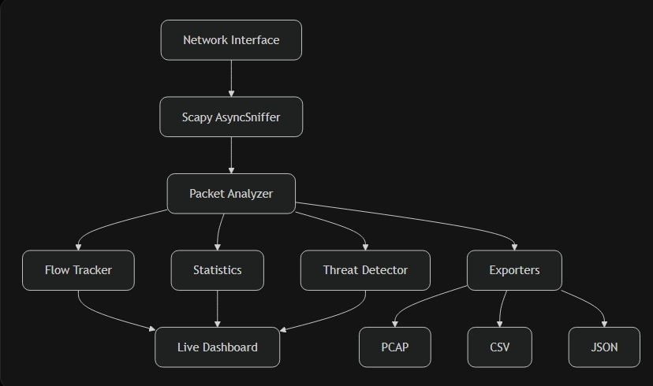

# Network Analyzer – Lightweight Network Monitoring & Anomaly Detection

A powerful Python-based network packet analyzer and lightweight IDS built with **Scapy**.

It captures live traffic (or analyzes existing PCAPs), decodes multiple protocols, tracks bidirectional flows, shows a real-time dashboard, detects suspicious patterns, and exports results to PCAP, CSV, and JSON.

---

## Features

- Live packet capture and offline PCAP analysis
- Protocol decoding: Ethernet, ARP, IPv4/IPv6, TCP, UDP, ICMP, DNS, HTTP, TLS
- Bidirectional **flow tracking**
- Real-time **Rich** dashboard
- Heuristic threat detection (port scans, SYN bursts, DNS bursts, connection bursts, sensitive ports, etc.)
- Export to **PCAP**, **CSV**, and **JSON**
- BPF filters, interface selection, packet count & timeout limits
- Graceful shutdown and final summary report

---

## Architecture
Screenshot_25-8-2026_133552_grok.com.jpeg


```text
Network Interface
        │
        ▼
┌───────────────────┐
│  Scapy Capture    │  (AsyncSniffer + optional TCPSession)
└─────────┬─────────┘
          │
          ▼
┌───────────────────┐
│  Packet Analyzer  │  → L2 / L3 / L4 / Application layers
└─────────┬─────────┘
          │
    ┌─────┴─────┬──────────────┐
    ▼           ▼              ▼
Flow Tracker  Statistics   Threat Detector
    │           │              │
    └─────┬─────┴──────────────┘
          │
          ▼
   Live Dashboard (Rich)
          │
    ┌─────┴─────┬─────────┐
    ▼           ▼         ▼
  PCAP         CSV       JSON
````

---

## Requirements

* Python 3.10 or higher
* Scapy ≥ 2.7.0
* Rich ≥ 14.0.0
* Colorama
* **Npcap** (Windows) or libpcap (Linux/macOS)
* Administrator / root privileges for live capture

---

## Installation

```bash
# Clone the repository
git clone https://github.com/eslavthsandeep/Network.git
cd Network

# Create virtual environment (recommended)
python -m venv venv
source venv/bin/activate          # Linux / macOS
# venv\Scripts\activate           # Windows

# Install dependencies
pip install -r requirements.txt
```

**Windows users:** Install [Npcap](https://npcap.com/) and run the terminal as Administrator.

---

## Usage

### List available interfaces

```bash
python main.py --interfaces
```

### Basic live capture with dashboard

```bash
python main.py --dashboard
```

### Capture a limited number of packets

```bash
python main.py --count 500 --dashboard
```

### Capture with timeout

```bash
python main.py --timeout 60 --dashboard
```

### Apply a BPF filter

```bash
python main.py --filter "tcp port 443" --dashboard
python main.py --filter "udp port 53" --dashboard
python main.py --filter "icmp" --dashboard
```

### Full capture with all exports

```bash
python main.py --count 1000 --dashboard \
  --pcap captures/network.pcap \
  --csv reports/packets.csv \
  --json reports/report.json
```

### Analyze an existing PCAP file

```bash
python main.py --read captures/network.pcap
python main.py --read captures/network.pcap --json reports/offline.json
```

### Enable TCP stream reconstruction (experimental)

```bash
python main.py --tcp-session --count 500 --dashboard
```

---

## Project Structure

```text
Network/
│
├── main.py
├── config.py
├── packet_analyzer.py
├── flow_tracker.py
├── statistics.py
├── threat_detector.py
├── dashboard.py
├── exporters.py
├── utils.py
├── requirements.txt
│
├── captures/          # Saved PCAP files
├── reports/           # CSV & JSON reports
├── docs/
│   └── demo/          # Screenshots and GIFs
└── tests/
```

---

## Detection Notes

The threat detection engine uses **behavioral heuristics**.
Alerts indicate *suspicious patterns*, **not confirmed attacks**.

Examples of detections:

* Possible port scans
* High SYN rate
* Connection bursts
* DNS query bursts
* Traffic to sensitive services (Telnet, SMB, RDP, etc.)
* Unusually large packets
* High RST / ICMP rates

---

## Limitations

* Detection is heuristic-based only
* Full TLS inspection is limited (mainly ClientHello SNI)
* Very high packet rates may require performance tuning
* Requires elevated privileges for live capture

---

## Future Improvements

* Flow-based machine learning anomaly detection
* Web dashboard (FastAPI + frontend)
* Better TCP stream reassembly integration
* HTML / PDF report generation
* Alert notifications

---

## Disclaimer

Only capture and analyze network traffic on systems and networks that you own or have explicit permission to monitor.

---

## License

MIT License

